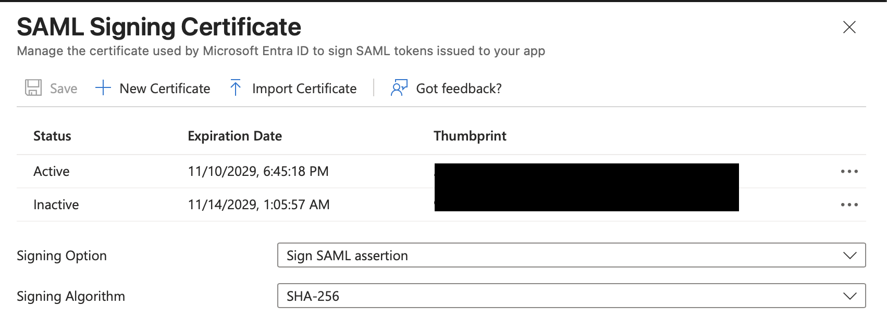
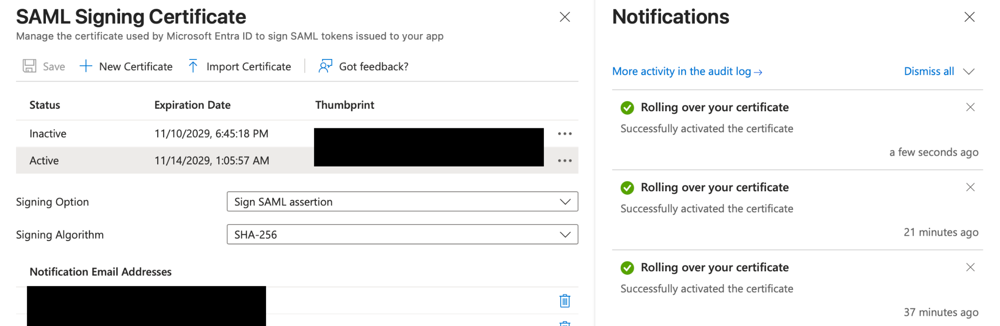

# When a Valid Login Still Fails | PKI Certificate Lifecycle & SAML Trust Engineering

**[Watch the 4-minute video walkthrough](https://www.loom.com/share/c56d91d83d5c4464b103cd808fa0dab3)

**Cedarbridge Health System (CHS)** · **PKI for IAM** · **Microsoft Entra ID** · **SAML 2.0** · **X.509** · **SHA-256** · **Certificate rotation & recovery** · **Zammad**

> **An employee passes MFA. Microsoft Entra ID accepts their identity. But the support portal still refuses to sign them in.**  
> The account isn't the problem. The application no longer trusts the certificate used to sign the SAML assertion.

That's the kind of failure I wanted to prevent in this project. In an IAM environment, **PKI isn't only about TLS certificates on web servers**. It's also the lifecycle of the signing certificates and public-key trust relationships that make federated authentication possible.

## The business problem — when identity is valid but trust is broken

At **Cedarbridge Health System**, my fictional healthcare organization, employees use a Zammad-based *Clinic Integration Support Desk* to report application and access issues. If its SAML sign-in breaks, support requests can be delayed—even when employee accounts, MFA, and Conditional Access are functioning as intended.

This integration has an operational dependency:

- **Microsoft Entra ID**, the identity provider (IdP), signs a SAML assertion with its **private signing key**.
- **Zammad**, the service provider (SP), verifies the signature using the corresponding **public key in an X.509 certificate** it trusts.
- When Entra rotates the signing certificate, **Zammad must trust the corresponding replacement** before the new signatures can be verified.

The original certificate was valid until **November 2029**. There was **no actual outage or imminent expiration**. I simulated a proactive rotation to test whether I could manage that PKI lifecycle dependency before it became an incident.

**The question:** Can I replace a federation signing certificate, preserve an administrative recovery route, verify SSO *after* the trust change, and prove that rollback works?

## My solution — own the certificate lifecycle, not just the SSO setting

| PKI / IAM responsibility | What I implemented | Why it matters |
| --- | --- | --- |
| **Certificate inventory & expiry** | Inspected active X.509 certificate, thumbprint, expiration date, SHA-256 signing settings, and notification contacts | Identify trust dependencies before they surprise application owners |
| **Certificate staging** | Generated replacement Certificate B in Entra and kept it **Inactive** | Prepare the renewal without changing the working SSO signing key |
| **Trust distribution** | Updated Zammad's **IdP Certificate** to the replacement public certificate, then activated B in Entra | Align the public verification key with the IdP's active signing key |
| **Authentication verification** | Tested **fresh CHS Employee SSO** as Jordan and reviewed the successful Entra application sign-in | An active certificate alone doesn't prove the SP accepts the assertion |
| **Rollback & availability planning** | Preserved original Certificate A and verified an **independent local Zammad admin** login before cutover | Avoid depending on the broken SSO path to repair SSO |
| **Recovery testing** | Reactivated A on both sides and tested fresh SSO; then returned to B and tested again | Validate a recovery procedure instead of merely documenting one |

### How the trust relationship works

```text
                         SAML authentication trust

  Microsoft Entra ID (IdP)                Zammad (Service Provider)
  ------------------------                -------------------------
  Private signing key A ─ signs ────────> SAML assertion
                                          Verifies using public
                                          certificate A  ✓

  Stage certificate B (Inactive)
  Verify independent admin recovery + preserve certificate A

  Cutover: Zammad trusts public certificate B → Entra activates B
  Fresh SSO test: new assertion signed with key B → verified by B  ✓

  Rollback test: restore public A in Zammad → reactivate A in Entra
  Fresh SSO test: original trust path works again  ✓

  Final state: B Active and trusted; A retained Inactive
```

## 1 — I established a known-good PKI baseline

I began in **Entra Enterprise Applications → SAML Signing Certificate** to identify the certificate currently signing assertions, its validity period, its thumbprint, the **Sign SAML assertion** option, and **SHA-256** signing algorithm. I also reviewed the certificate-expiration notification contacts.

In Zammad I confirmed the existing public **IdP Certificate** was configured and SSL verification remained enabled. Then I signed in through CHS Employee SSO before changing anything.

**Evidence:** [Original signing certificate](Evidence/01-Baseline/PKI-Certificate-Baseline.png) · [Zammad's trusted IdP certificate configuration](Evidence/01-Baseline/PKI-Zammad-Trust-Baseline.png)

**PKI takeaway:** You cannot manage certificate risk without knowing which certificate is active, when it expires, who owns the change, and which service providers depend on it.

## 2 — I staged the replacement without disrupting the working certificate

I generated **Certificate B**, an Entra-managed X.509 SAML signing certificate, and left it **Inactive** while **Certificate A remained Active**. I downloaded the public certificates for the planned trust changes and retained the original Zammad certificate configuration privately.

The most important decision was made **before the cutover**: I verified that a **local Zammad administrator could still sign in without SAML**. If certificate trust failed during the rollover, I would still have a route to repair it.



**PKI takeaway:** The recovery path and original certificate must be available *before* promoting the replacement.

## 3 — I rotated the signing certificate and verified the application, not just Entra

Zammad has a single configured IdP certificate field. I coordinated a manual cutover: update Zammad to trust public **Certificate B**, then make **B Active** in Entra. This creates a possible brief mismatch window, so I am **not claiming a zero-downtime rollover**.

After activation, I opened a fresh browser session and signed in as **Jordan Lee**, our fictional test employee. Zammad loaded successfully, and the corresponding Entra log showed **Success** for **CHS – Clinic Integration Support Desk**.

**Evidence:** [Replacement certificate activated](Evidence/03-Rollover/PKI-Certificate-Rollover-Activated.png) · [Successful application sign-in](Evidence/03-Rollover/PKI-SSO-Post-Rotation-Success.png) · [Zammad support-desk access](Evidence/03-Rollover/PKI-Zammad-Post-Rotation-Access.png)

**PKI takeaway:** A new certificate being *Active* does not mean the service provider trusts it. Successful **new federation authentication** verifies the handoff.

## 4 — I proved rollback, then restored the intended final state

Next I deliberately reversed the change. I restored the original public certificate in Zammad, reactivated **Certificate A** in Entra, and tested a new CHS SSO login. It worked.

Zammad also prompted an already-open session to reload its configuration. **That reload was not proof of authentication**. I signed out and initiated a fresh SSO login instead.

Finally, I repeated the cutover to **Certificate B**, made it Active again, and verified another fresh SSO login. I retained A as an Inactive recovery option rather than deleting it during the test.



**Evidence:** [Original certificate restored](Evidence/04-Rollback-Recovery/PKI-Rollback-Original-Restored.png) · [Final Entra certificate state](Evidence/04-Rollback-Recovery/PKI-Certificate-Final-State.png) · [Zammad configuration-reload notice (not sign-in proof)](Evidence/04-Rollback-Recovery/PKI-Zammad-Config-Reload-Notice.png)

The **final fresh login succeeded in the hands-on test**; a separate final successful-sign-in record was not included in this screenshot collection.

**PKI takeaway:** A change plan should include **verified rollback**, an explicit recovery operator, and a fresh authentication test—not just instructions to reverse the certificate status.

## What I demonstrated—and what I'd change in production

**Demonstrated:** X.509 signing-certificate inventory, SAML 2.0 signing trust, SHA-256 configuration review, certificate staging and rotation, manual IdP/SP trust coordination, expiration-notification configuration, independent admin recovery, fresh authentication validation, rollback, and return to the replacement.

**Not demonstrated:** Running a certificate authority, managing private signing keys or an HSM, enterprise-wide certificate discovery, automatic metadata-based rotation, verified expiration-email delivery, observed production outage, or a guaranteed zero-downtime deployment.

For a production healthcare service, I would add an owned certificate register, monitored expiry-alert distribution list, scheduled maintenance and change approval, application-owner signoff, post-change monitoring, and automated federation metadata support when the SP allows it. The old certificate would eventually be retired under a separately approved change.

---

**[Rotation & Recovery Runbook](Docs/Certificate-Rotation-Runbook.md)** · **[Evidence index](Evidence/README.md)**

*Portfolio lab using fictional Cedarbridge Health System identities and a working Entra–Zammad SAML integration. This is a demonstration of **PKI lifecycle responsibility within IAM engineering**, not a claim of owning a full enterprise PKI or responding to an actual outage.*
